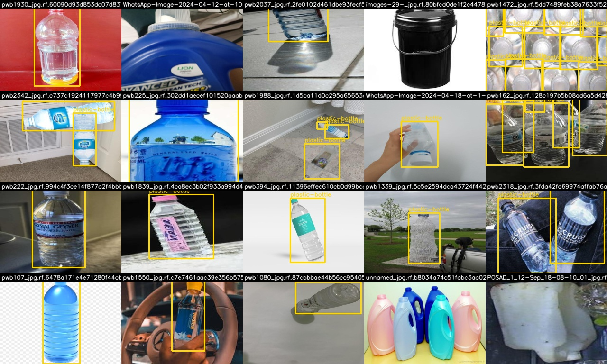

# Dataset review

Dataset: `data\plastic_bottles_yolo`

## Boxes per class

| name | train | val | test | total |
|---|---:|---:|---:|---:|
| plastic-bottle | 2515 | 1970 | 1215 | 5700 |

## Split statistics

| split | images | boxes | boxes per image | median box area (% of image) | boxes < 1% of image |
|---|---:|---:|---:|---:|---:|
| train | 1665 | 2515 | 1.51 | 11.28 | 126 |
| val | 1394 | 1970 | 1.41 | 16.52 | 31 |
| test | 700 | 1215 | 1.74 | 14.05 | 22 |

## Quality checks

| check | count | first examples |
|---|---:|---|
| images_without_label | 0 |  |
| labels_without_image | 0 |  |
| empty_labels | 417 | train/000001_1672742699_webp.rf.8f7688ab63859102fd6df26ae813be0f.txt, train/011f4a7b7de1b6b6ebb007a5ea225040-png_240x240q80-png__webp.rf.d6b1e821269aa29bad29139487d58857.txt, train/0313dbfa9676f902e82ba8019248f456_jpg.rf.61a88ece227fc1cc5896341523f69ab1.txt, train/10-litre-plastic-bucket-500x500_webp.rf.f2b9957d63191bfcb178f8aab031215e.txt, train/16131350341090f9877657a233e23d56bf8f8d7ffe_jpg.rf.65456f8ef9de13f6fef8241d1cc6fe65.txt |
| out_of_range_boxes | 0 |  |
| unknown_class_ids | 0 |  |
| tiny_boxes_lt_0.1pct | 4 | train/pwb1310_jpg.rf.abf27041fa6149cae4c770e9649f4ff5.txt (box 14), train/pwb2269_jpg.rf.49cc110957c4b308b5cb7ebc7960312b.txt (box 4), train/pwb2269_jpg.rf.49cc110957c4b308b5cb7ebc7960312b.txt (box 12), test/WhatsApp-Image-2024-04-08-at-5-23-25-PM-1-_jpeg.rf.4b34059523a4eeaa699bd5fb0f5ec9d1.txt (box 1) |
| duplicates_across_splits | 2 | test/PET1-748_jpg.rf.1711a7322b7b7d7653ac852697540723.jpg = val/plastic353_jpg.rf.9062494ec5af7b3c40be489c51c0b84c.jpg, test/PET1-761_jpg.rf.f3ff8a0b2ede99e423b753ab6ef4029e.jpg = val/plastic393_jpg.rf.bc0ca96b4f78c16a9ce9c2178c3f036c.jpg |

## Label conversions

When the dataset was prepared, each polygon (segmentation) label line was replaced by its enclosing box: the minimum and maximum x and y of its points, clipped to 0-1. Lines that could not be used were dropped. Every such line is listed in `label_conversions.csv` in the dataset folder; the raw dataset is unchanged.

| split | converted | dropped: malformed | dropped: invalid |
|---|---:|---:|---:|
| train | 1 | 0 | 0 |
| val | 2 | 0 | 0 |
| test | 15 | 0 | 0 |
| total | 18 | 0 | 0 |

First examples: train/images-14-_jpg.rf.eb1931dfda5819d3c9e5a8323ccf635e.txt line 1 (14 values, converted), val/images-6-_jpg.rf.b1930770c8701d93ced516b85927fadc.txt line 1 (16 values, converted), val/WhatsApp-Image-2024-04-07-at-12-41-58-AM-2-_jpeg.rf.ed1bb3113bc91bf4f75bada8e8bb08b4.txt line 2 (16 values, converted), test/images_jpg.rf.ef7ca9359b04579876405a4d045ab1d7.txt line 2 (12 values, converted), test/images_jpg.rf.ef7ca9359b04579876405a4d045ab1d7.txt line 3 (16 values, converted)

## Sample grid

20 training images (seed 0):

